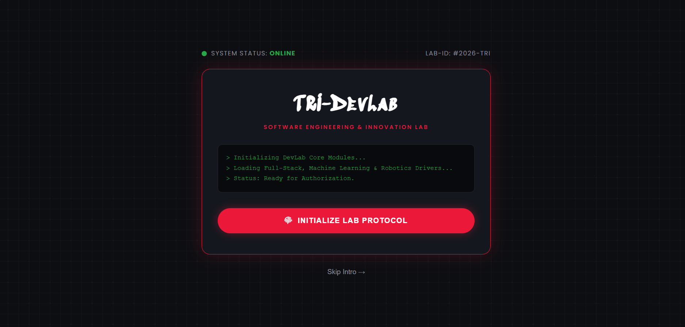

# TRI-DevLab — Personal Portfolio Website

[](https://tri-devlab.github.io/personal-portfolio/)
[](https://github.com/TRI-DevLab/personal-portfolio/releases)
[](https://tri-devlab.github.io/personal-portfolio/)
[](LICENSE)

A modern, accessible, and responsive personal portfolio website showcasing software development projects, technical skills, academic milestones, and technical writeups.

🌐 **Live Demo:** [tri-devlab.github.io/personal-portfolio](https://tri-devlab.github.io/personal-portfolio/)



---

## About

This portfolio serves as a central hub for my work and achievements. It highlights my engineering journey, software development projects, academic journey, and ongoing learning while providing an easy way for visitors to learn more about me and get in touch.

The website is designed to grow alongside my experience, with new projects, certifications, and accomplishments added over time.

## Features

* Responsive design for desktop, tablet, and mobile
* Modern and clean user interface
* Interactive DevLab Boot Sequence
* Dynamic Theme Switcher:
* Skills and technologies
* Project showcase & Filtering
* Technical Learning Journal (Blog)
* Education and certifications
* Interactive Contact Pipeline:
* Downloadable résumé/CV
* Links to GitHub and LinkedIn

## Tech Stack

* **Frontend:** HTML5 (Semantic Landmarks), CSS3 (Custom Variables, Flexbox, Grid), Vanilla JavaScript (ES6+)
* **Icons & Fonts:** FontAwesome 6, Google Fonts (Poppins, Sedgwick Ave Display)
* **Services:** EmailJS API, GitHub Pages CI/CD
* **Version Control:** Git, GitHub Projects

## Future Improvements

* React migration
* Tailwind CSS
* Backend contact form
* Continuous deployment

## Getting Started

### Clone the repository

```bash
git clone https://github.com/TRI-DevLab/personal-portfolio.git
```

### Open the project

Open `index.html` in your browser, or use the VS Code Live Server extension for the best development experience.

## Project Structure

```text
personal-portfolio/
│
├── index.html              # Main application entry point
├── 404.html                # Custom error page for GitHub Pages
├── robots.txt              # Search engine crawler directives
├── sitemap.xml             # XML sitemap with route anchors
├── site.webmanifest        # PWA & mobile installation manifest
├── README.md               # Repository documentation
│
├── css/                    # Modular stylesheet architecture
│   ├── style-main.css      # Core resets, typography, and theme variables
│   ├── style-aside.css     # Navigation sidebar & drawer styles
│   ├── style-home.css      # Hero section & avatar graphic styling
│   ├── style-about.css     # Bio, stats, and skill progress bars
│   ├── style-journey.css   # Academic & experience timeline styles
│   ├── style-skills.css    # Technical skills grid & badge styles
│   ├── style-projects.css  # Project grid, filters, and modal view
│   ├── style-blogs.css     # Blog grid & category filter styling
│   ├── style-blog-r.css    # Full-screen article reader overlay
│   ├── style-contact.css   # Contact form & availability cards
│   ├── style-footer.css    # Footer layout & back-to-top button
│   ├── style-open.css      # DevLab boot terminal / splash screen
│   └── style-responsive.css# Consolidated master breakpoint overrides
│
├── js/                     # Modular vanilla client logic
│   ├── script.js           # Core application init
│   ├── script-splash.js    # Interactive boot screen & session logic
│   ├── script-navigation.js# Section routing & mobile drawer toggler
│   ├── script-themes.js    # Color presets & dark/light mode persistence
│   ├── script-projects.js  # Project search, filter, and modal triggers
│   ├── project-data.js     # Structured dataset for portfolio projects
│   ├── script-blogs.js     # Article reader modal & search logic
│   ├── blog-data.js        # Structured dataset for blog writeups
│   └── script-contact.js   # Form validation & EmailJS dispatch
│
└── assets/                 # Static media assets
    ├── icons/              # Favicon SVGs and app icons
    └── images/             # Profile avatars and project media
```

## Author

**Triumphant Bamitale**

* GitHub: https://github.com/TRI-DevLab
* LinkedIn: https://www.linkedin.com/in/tri-bam

## License

This project is licensed under the MIT License.
